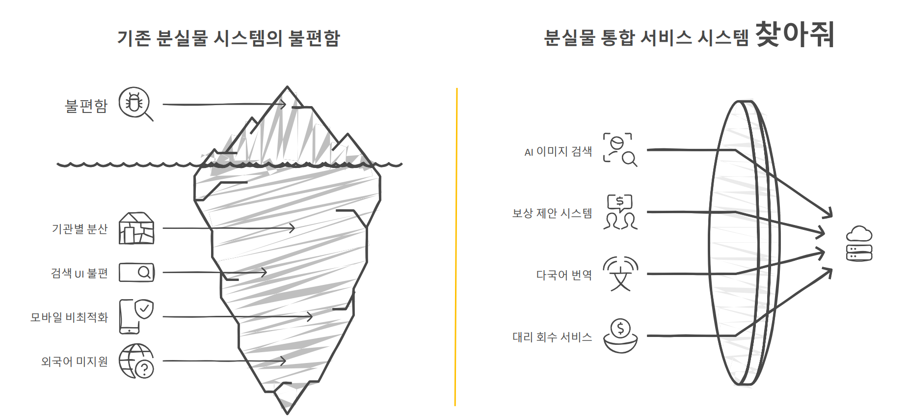
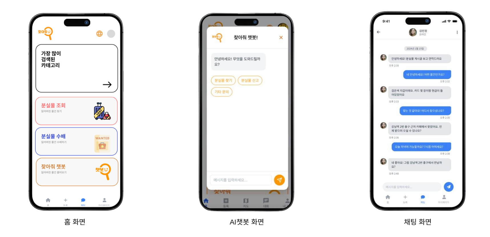
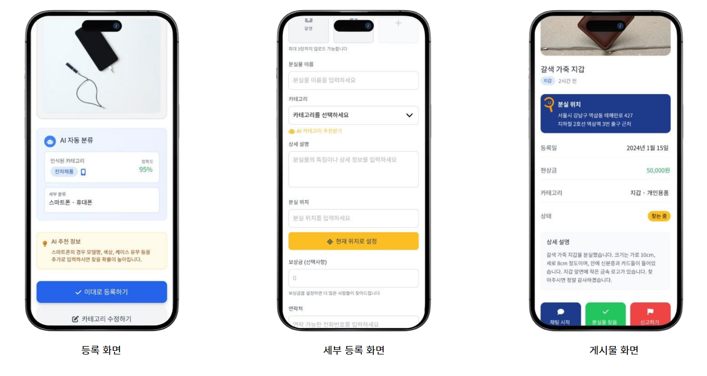

# Grinning (그리닝)

유실물 플랫폼 **그리닝의 Django 백엔드**입니다. 분실물·습득물 게시판, 사진 분류, 유사 게시글 추천, 사용자 간 채팅 API를 제공하고, 경찰청 유실물 데이터를 수집해 함께 조회합니다. 화면은 [grinning-front](https://github.com/KNUT-Hacker-Grins/grinning-front)에서 개발합니다.


## 주요 기능

- **분실물·습득물 게시판:** 등록·조회·수정·삭제와 상태 변경
- **사진 분류:** YOLOv8로 사진 속 물품의 카테고리 분류
- **챗봇·추천:** Gemini로 물품 설명을 정리하고, TF-IDF 유사도로 비슷한 분실물 게시글 추천
- **경찰청 데이터:** 외부 API에서 받은 분실물·습득물 정보를 DB에 저장해 조회
- **회원·채팅:** Google·Kakao 로그인, JWT 인증, 채팅과 읽음 처리
- **지도·업로드:** 지도 표시용 좌표 조회, S3 이미지 업로드

## 로컬 실행

Python 3.12와 AWS S3 버킷이 필요합니다. DB는 `.env.example`이 PostgreSQL을 예로 들고 있으니 따로 준비합니다. Linux에서는 OpenCV용 `libgl1`, `libglib2.0-0`도 설치합니다. 쓰는 기능에 따라 Google·Kakao OAuth, Gemini, 경찰청 API 키도 준비합니다. 명령은 저장소 루트에서 실행합니다.

```sh
pip install -r requirements/server.txt
cp .env.example .env    # 값 채우기
```

`.env`의 묶음은 Django(`SECRET_KEY`, `DATABASE_URL` 등), AWS S3, Google·Kakao OAuth, AI·외부 API(`GEMINI_API_KEY`, `POLICE_API_KEY`)입니다. 전체 항목은 [`.env.example`](.env.example)에 있습니다.

> [!NOTE]
> - OAuth 콜백의 실제 경로는 `/api/auth/google/callback`, `/api/auth/kakao/callback`입니다. `.env.example`의 예시 경로와 다릅니다.
> - 로그인 성공 후 이동할 프론트엔드 주소는 [`callback.py`](src/apps/accounts/views/callback.py)에 고정돼 있습니다.
> - `CORS_ALLOWED_ORIGINS`는 환경변수가 아니라 [`cors_csrf.py`](src/config/settings/components/cors_csrf.py)에서 정합니다.

저장소에 마이그레이션 파일이 없어, 처음에는 생성부터 합니다.

```sh
python src/main.py makemigrations accounts messaging chatbot questionnaire found_items lost_items reports lost_insight police
python src/main.py migrate
python src/main.py runserver
```

`http://127.0.0.1:8000/api/chatbot/health`로 동작을 확인할 수 있습니다. 사진 분류는 저장소에 포함된 가중치(`src/ml/vision/models/`)를 CPU로 실행합니다.

## Docker Compose 배포

먼저 로컬 실행의 `.env` 준비와 마이그레이션 생성을 마칩니다. 컨테이너는 마이그레이션을 적용만 합니다.

[`docker-compose.yml`](docker-compose.yml)은 Django(Gunicorn)와 Nginx를 띄웁니다. DB는 포함하지 않으니 `DATABASE_URL`에 컨테이너에서 접속할 수 있는 주소를 넣습니다. 운영에서는 `DEBUG=False`로 두고, 배포 도메인을 [`cors_csrf.py`](src/config/settings/components/cors_csrf.py)의 `ALLOWED_HOSTS`와 `CORS_ALLOWED_ORIGINS`에 넣습니다.

```sh
docker compose up -d --build
```

웹 컨테이너는 마이그레이션 적용, 정적 파일 수집, Gunicorn 실행 순서로 시작합니다. Nginx는 80번 포트(HTTP)를 씁니다.

> [!WARNING]
> [자동 배포 워크플로](.github/workflows/deploy.yml)와 [`deploy/remote-deploy.sh`](deploy/remote-deploy.sh)는 이전 구조 기준입니다. 지금 없는 `manage.py`, `docker-compose.prod.yml`, PM2 설정을 참조합니다.

## 개발 배경

기관마다 흩어진 유실물 정보를 한곳에서 조회하고, 물품을 등록하고 찾는 과정을 돕기 위해 만든 팀 프로젝트입니다.



## 👥 팀원 정보

| 사진 | GitHub | 담당 기능 |
| :---: | :---: | :--- |
|  | [@kth4778](https://github.com/kth4778) | - 로그인 기능 개발<br>- 경찰청 습득물 API 명세서 작성<br>- 기획 및 로고 디자인 제작 |
|  | [@joon0890](https://github.com/jwhitekim) | - YOLO AI 모델 개발<br>- 챗봇 AI 담당<br>- 게시판 처리 |

## 📸 화면별 이미지




## 라이선스

LICENSE 파일이 없습니다. 라이선스는 확인이 필요합니다.
